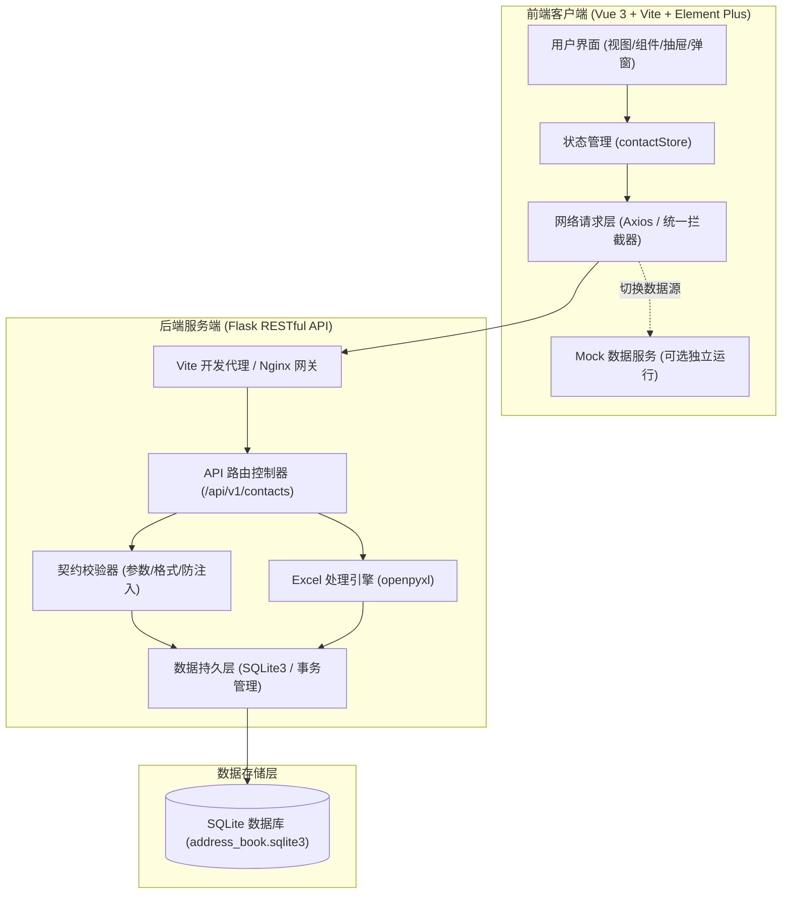
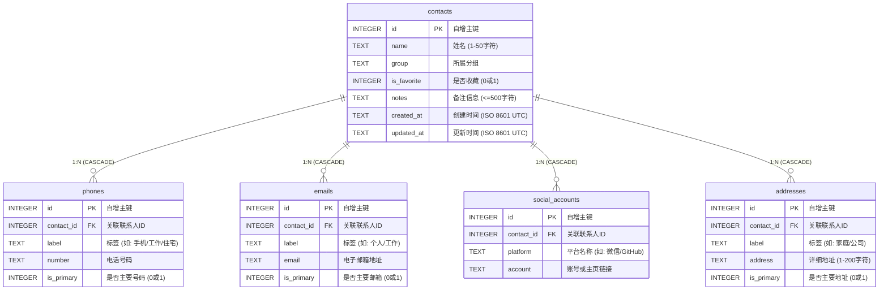
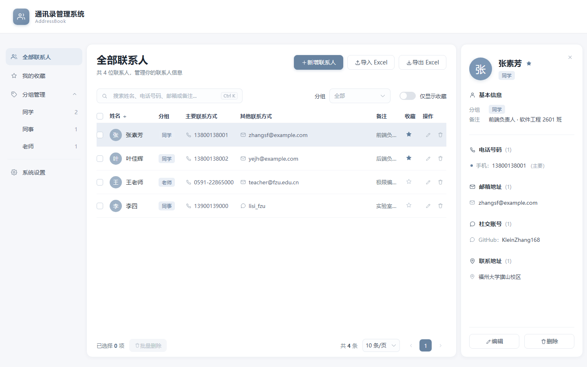
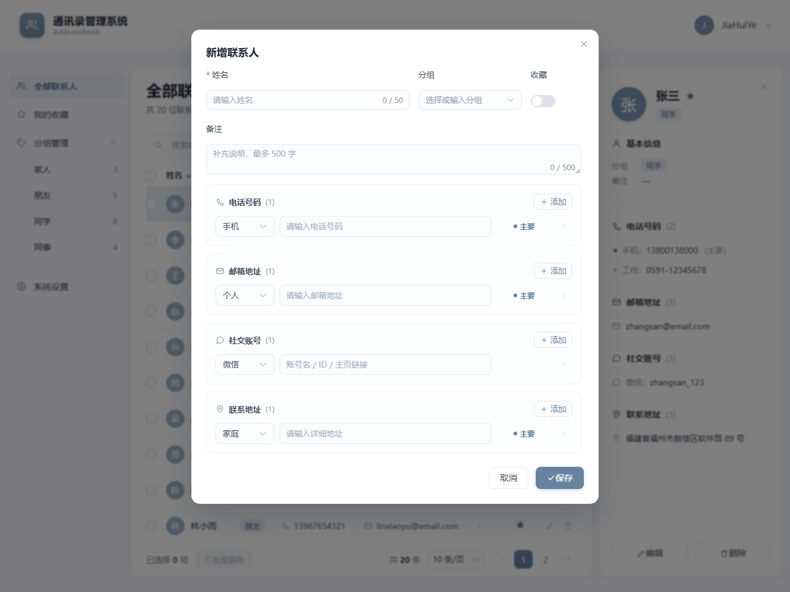
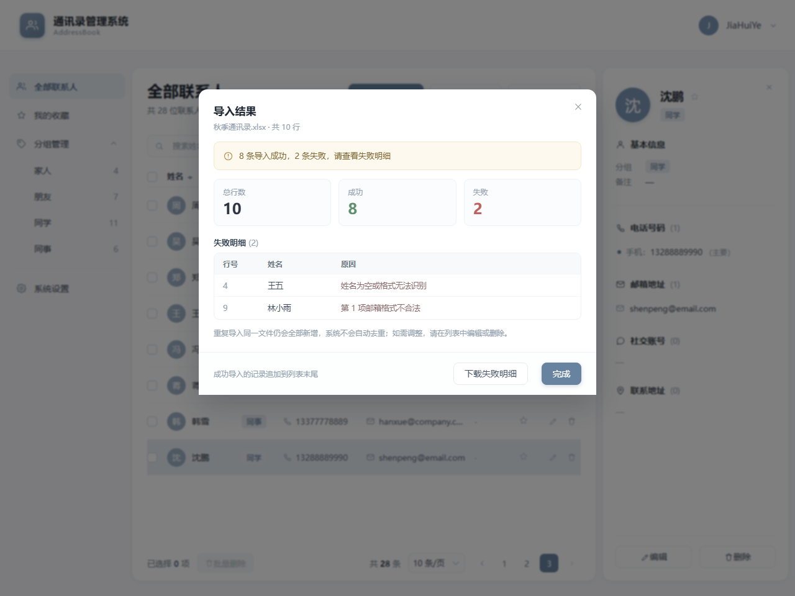
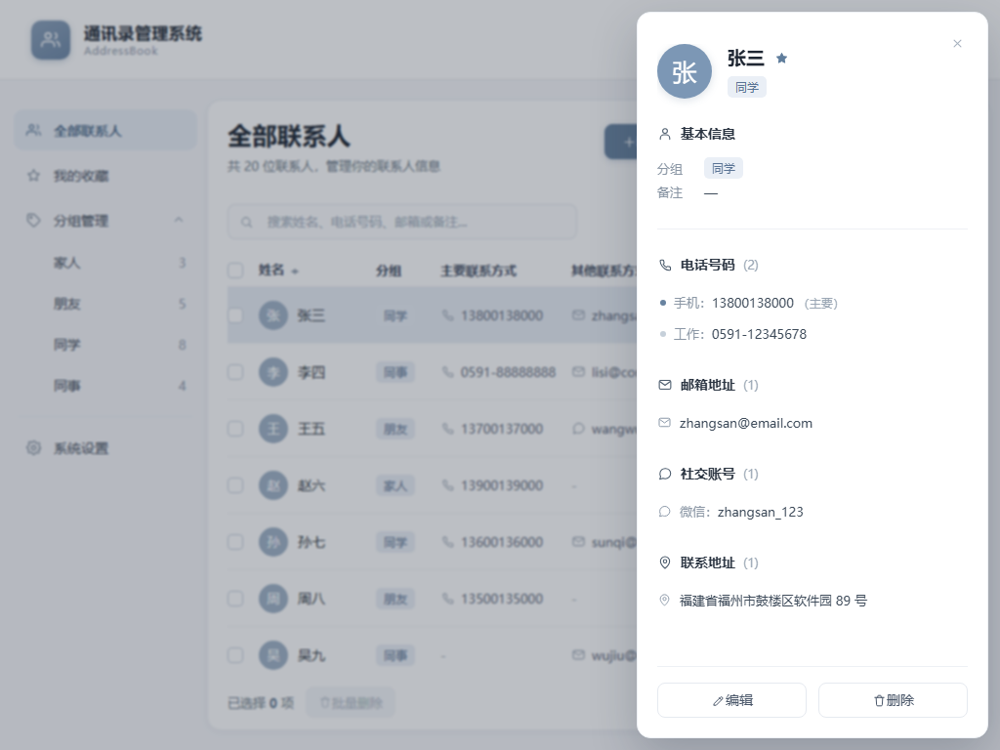
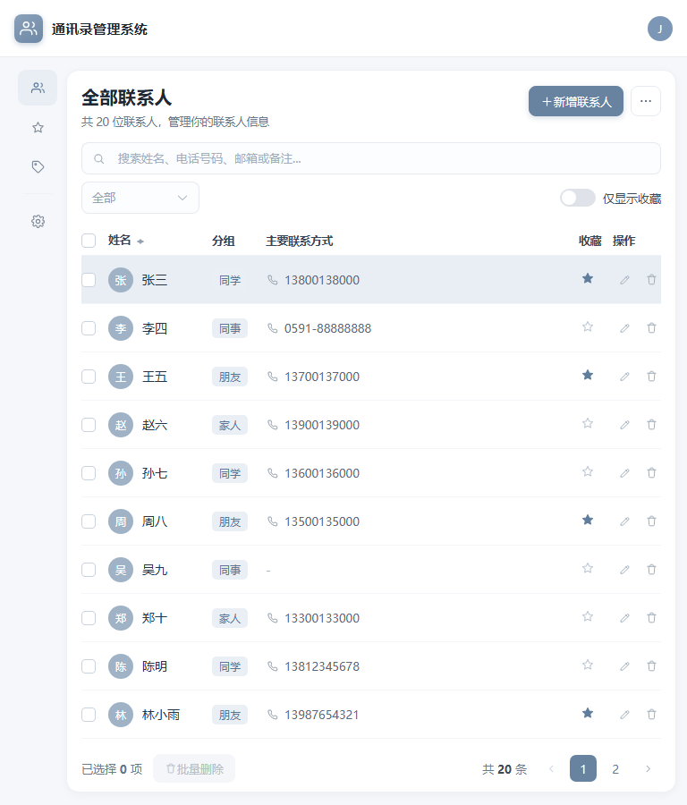
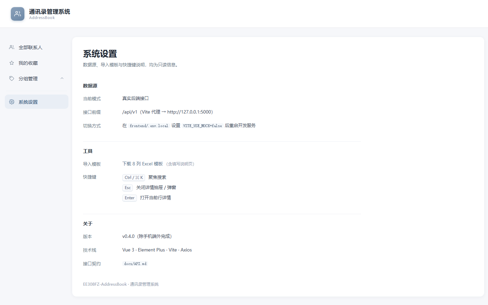

# 联系人管理与数据交换系统 (ContactHub)

[](https://github.com/Fatespur/ContactHub/actions/workflows/ci.yml)
[](LICENSE)
[](https://www.python.org/)
[](https://flask.palletsprojects.com/)
[](https://vuejs.org/)
[](https://vitejs.dev/)
[](https://element-plus.org/)

ContactHub（联系人管理与数据交换系统）是一套基于现代 Web 前后端分离架构设计的专业通讯录与联系人数据交换中台。系统聚焦于多属性联系人生命周期管理、结构化数据组织、全字段实时检索以及企业级规范的 Excel（`.xlsx`）双向数据批量交换。

本项目采用全栈工程化架构设计，前端提供全要素简体中文交互界面，后端具备完备的 UTF-8 中文字符集支持与企业级数据校验能力。

> **项目源起与演进说明**：本项目最初源自软件工程结对编程项目（福州大学 EE308FZ 课程项目 `EE308FZ-AddressBook`，由 Ye Jiahui 负责后端架构与接口设计、Zhang Sufang 负责前端界面与交互实现）；后续由 Fatespur 进行工程化演进、全要素中文化重构、安全加固与持续维护，升级为独立的 ContactHub 开源项目。

---

## 目录

- [1. 项目介绍与功能概览](#1-项目介绍与功能概览)
- [2. 技术栈](#2-技术栈)
- [3. 系统架构](#3-系统架构)
- [4. 项目目录](#4-项目目录)
- [5. 本地运行方式](#5-本地运行方式)
- [6. 前后端配置](#6-前后端配置)
- [7. 数据库设计](#7-数据库设计)
- [8. Excel 数据交换](#8-excel-数据交换)
- [9. 自动化测试](#9-自动化测试)
- [10. 部署指南](#10-部署指南)
- [11. 项目截图](#11-项目截图)
- [12. 开源协议与作者](#12-开源协议与作者)

---

## 1. 项目介绍与功能概览

### 1.1 核心价值

ContactHub 旨在解决企业和个人管理海量联系人时面临的信息碎片化、格式不统一、批量导入导出易乱码、多端体验割裂等痛点。系统严格遵循 RESTful API 设计规范，结合前端轻量高性能的响应式交互，提供高可靠的数据持久化与安全校验。

### 1.2 核心功能矩阵

| 业务模块 | 功能特性 | 详细描述 |
| --- | --- | --- |
| **联系人管理 (CRUD)** | 完整生命周期管理 | 支持创建、查看、更新、单条与批量删除联系人；更新采用幂等全量替换语义（`PUT`），保障主子表数据完全一致。 |
| **多维属性维护** | 多类型通讯凭据 | 每个联系人支持配置多条电话、邮箱、社交平台账号（微信、QQ、GitHub、LinkedIn 等）及地理地址，并支持指定各分类的「主要」联络项。 |
| **智能检索与筛选** | 毫秒级多字段联动 | 支持中文姓名、备注、电话、邮箱、联系地址的防抖实时检索；支持分组筛选、分组统计计数、快捷收藏置顶。 |
| **数据交换 (Excel)** | 规范化批量导入导出 | 严格遵循标准 8 列契约，支持导出当前筛选结果为 `.xlsx`；导入支持格式校验、防公式注入、行级原子事务、失败原因汇总与 CSV 错误清单下载。 |
| **现代交互体验** | 响应式布局与无障碍 | 支持桌面端（宽屏三栏）、平板端（抽屉式详情）及移动端自适应；支持快捷键（`Ctrl/⌘ + K` 聚焦搜索、`Esc` 退出、`Enter` 快速查看详情）；内置独立 Mock 模式与真实后端快速切换。 |

---

## 2. 技术栈

| 领域 | 核心技术 / 库 | 版本规范 | 用途与说明 |
| --- | --- | --- | --- |
| **前端架构** | Vue 3 | `^3.5.0` | 采用 Composition API 与 `<script setup>` 响应式开发范式 |
| **构建工具** | Vite | `^7.0.0` | 新一代前端轻量快速构建工具，具备毫秒级热更新 |
| **UI 组件库** | Element Plus | `^2.14.0` | 企业级 UI 组件系统，已全面配置简体中文本地化（zh-cn） |
| **网络请求** | Axios | `^1.21.0` | 封装全局拦截器、请求超时重试、统一异常处理与文件下载流 |
| **后端框架** | Python / Flask | `3.1+` | 轻量级高性能 WSGI Web 框架，提供纯正 RESTful JSON 接口 |
| **数据库** | SQLite 3 | 内置 | 支持 ACID 事务管理与 `PRAGMA foreign_keys = ON` 外键级联 |
| **表格处理** | openpyxl | `^3.1.0` | 纯 Python 实现的 Excel 2010+ xlsx 读写库，安全流式处理 |
| **跨域支持** | Flask-CORS | `^6.0.0` | 精细化控制跨域资源共享及白名单校验 |
| **测试框架** | pytest / pytest-cov | `^8.0.0` | 提供包含 API 合约、并发、中文专项及异常安全的全量测试套件 |

---

## 3. 系统架构

系统采用清晰的前后端解耦与分层架构模式：



---

## 4. 项目目录

```text
ContactHub/
├── backend/                      # Flask 后端服务根目录
│   ├── app/                      # 后端应用核心包
│   │   ├── __init__.py           # 工厂模式、路由定义、全局异常拦截、搜索过滤
│   │   ├── db.py                 # SQLite 数据库连接池、外键约束、CRUD 数据助手
│   │   ├── excel.py              # Excel 8 列导入解析、数据校验、流式导出控制器
│   │   └── schema.sql            # 数据库结构与完整外键约束定义
│   ├── tests/                    # 自动化测试套件
│   │   ├── test_api.py           # 基础 API CRUD 与参数契约测试
│   │   ├── test_chinese_features.py # 中文 CRUD、搜索过滤、Excel 读写专项测试
│   │   ├── test_deployment.py    # 生产部署、WSGI 入口与环境变量测试
│   │   └── test_excel.py         # Excel 边界条件、公式注入防护与回滚测试
│   ├── pytest.ini                # Pytest 本地化与临时文件配置
│   ├── requirements.txt          # 生产依赖清单
│   ├── requirements-dev.txt      # 开发与测试依赖清单
│   ├── run.py                    # 本地开发启动入口 (5000 端口)
│   ├── wsgi.py                   # 生产 WSGI 伺服入口
│   └── README.md                 # 后端详细技术说明
├── frontend/                     # Vue 3 前端工程根目录
│   ├── public/                   # 静态公开资源
│   │   └── templates/            # 标准 8 列联系人导入 Excel 模板
│   ├── src/                      # 前端源代码
│   │   ├── api/                  # 接口请求层 (contacts.js, request.js, mock.js)
│   │   ├── components/           # 组件库
│   │   │   ├── common/           # 通用图标、拖拽上传区域组件
│   │   │   ├── contact/          # 表格、详情抽屉、编辑弹窗、导入导出弹窗
│   │   │   └── layout/           # 页面顶部栏、侧边栏导航组件
│   │   ├── composables/          # 响应式视口与断点检测
│   │   ├── constants/            # 选项常量、标签类型预设
│   │   ├── mock/                 # 前端独立演示数据集
│   │   ├── router/               # Vue Router 路由定义
│   │   ├── stores/               # 响应式状态管理仓库
│   │   ├── styles/               # 设计变量、样式重置、Element Plus 覆盖样式
│   │   ├── utils/                # 辅助函数、Excel/CSV 编解码、文件下载器
│   │   ├── views/                # 视图层 (ContactListView, SettingsView)
│   │   ├── App.vue               # 顶层布局外壳
│   │   └── main.js               # 应用挂载与 Element Plus 中文语言包配置
│   ├── package.json              # 前端依赖与构建脚本
│   ├── vite.config.js            # Vite 配置与反向代理定义
│   └── README.md                 # 前端架构与交互文档
├── docs/                         # 项目技术文档与资产
│   ├── blog/                     # 系统运行演示截图与发布资产
│   ├── ACCEPTANCE.md             # 验收测试规范
│   ├── API.md                    # RESTful API 完整规范接口契约
│   ├── BLOG.md                   # 项目工程演进总结
│   ├── CODING_STANDARDS.md       # 代码风格与开发规范
│   └── DEPLOY_RENDER.md          # 历史部署参考文档
├── render.yaml                   # 平台 IaC 部署配置参考
├── .gitignore                    # Git 忽略配置
└── README.md                     # 项目中文主文档
```

---

## 5. 本地运行方式

### 5.1 环境需求

- **Python**: 推荐 `3.10` 及以上版本（本地开发基于 Python 3.13.6 执行 65 项自动化测试验证全部通过；跨版本兼容性由 GitHub Actions CI 矩阵保障）
- **Node.js**: `20.19+` 或 `22.12+`（适配 Vite 7 生产构建）
- **npm**: `10.0+`

---

### 5.2 后端服务启动

1. 进入后端目录：
   ```bash
   cd backend
   ```

2. 创建并激活虚拟环境：
   - **Windows (PowerShell)**:
     ```powershell
     python -m venv .venv
     .\.venv\Scripts\Activate.ps1
     ```
   - **macOS / Linux**:
     ```bash
     python3 -m venv .venv
     source .venv/bin/activate
     ```

3. 安装依赖包：
   ```bash
   pip install -r requirements-dev.txt
   ```

4. 启动本地开发服务：
   ```bash
   python run.py
   ```
   服务将监听在 `http://127.0.0.1:5000`，数据库文件将在首次启动时自动初始化。

---

### 5.3 前端服务启动

1. 进入前端目录：
   ```bash
   cd frontend
   ```

2. 安装依赖：
   ```bash
   npm install
   ```

3. 启动开发服务器：
   ```bash
   npm run dev
   ```
   启动后访问 `http://localhost:5173` 即可进入系统。

---

## 6. 前后端配置

### 6.1 前端环境切换

前端支持通过配置环境变量在 **Mock 纯前端预览模式** 与 **后端真实联调模式** 之间无缝切换：

1. 在 `frontend/` 目录下创建 `.env.local` 文件：
   ```ini
   # 设置为 false 则连接真实 Flask 后端；设置为 true 则启用前端 Mock 演示数据
   VITE_USE_MOCK=false

   # 后端 API 地址（本地开发默认留空，由 Vite 代理转发 /api/v1 到 http://127.0.0.1:5000）
   VITE_API_BASE_URL=
   ```

2. 重启前端开发服务即可生效。

### 6.2 后端环境变量

后端支持通过系统环境变量控制数据库路径与跨域来源：

| 环境变量 | 默认值 | 说明 |
| --- | --- | --- |
| `DATABASE` | `instance/address_book.sqlite3` | SQLite 数据库文件的绝对或相对路径 |
| `CORS_ORIGINS` | `http://localhost:5173` | 允许跨域访问的前端域名，多域名以逗号分隔，支持 `*` |
| `FLASK_ENV` | `development` | 运行环境模式 |

---

## 7. 数据库设计

系统采用规范化关系模型，通过 1 个主表与 4 个子表存储结构化联系人数据，并通过外键约束保证数据完整性：



### 数据完整性保障机制

- **外键级联删除 (`ON DELETE CASCADE`)**：主表联系人记录被删除时，所有从属电话、邮箱、社交账号和地址将自动在底层事务中级联清理，杜绝产生孤立脏数据。
- **CHECK 约束**：数据库引擎层级强制校验字符长度及布尔整型有效域。
- **全量替换事务保证**：在调用 `PUT /api/v1/contacts/{id}` 更新时，通过单次数据库事务先清理原有子项再插入新子项，失败时自动完整回滚。

---

## 8. Excel 数据交换

ContactHub 具备企业级的双向 Excel 数据导入导出规范：

### 8.1 标准 8 列数据契约

| 列序号 | 列名 | 字段含义 | 格式要求与示例 |
| --- | --- | --- | --- |
| 1 | **姓名** | 联系人姓名 | 必填，1–50 字符。例如：`张三` |
| 2 | **分组** | 归属分类 | 选填。例如：`研发团队` |
| 3 | **是否收藏** | 收藏标记 | 填 `是`/`否`、`true`/`false` 或 `1`/`0` |
| 4 | **电话** | 电话号码列表 | 支持换行符分隔多个。格式：`标签*:号码`（`*` 代表主要）。例如：`手机*:13800138000\n工作:0591-88888888` |
| 5 | **邮箱** | 电子邮箱列表 | 支持换行符分隔多个。格式：`标签*:邮箱`。例如：`工作*:zhang@example.com` |
| 6 | **社交账号** | 社交主页/账号 | 支持换行符分隔多个。格式：`平台:账号`。例如：`微信:zhangsan_wx\nGitHub:zhang` |
| 7 | **地址** | 地理地址列表 | 支持换行符分隔多个。格式：`标签*:地址`。例如：`公司*:北京市海淀区中关村南大街1号` |
| 8 | **备注** | 补充说明 | 选填，最多 500 字符。 |

### 8.2 安全性与健壮性防护

1. **防公式注入 (Formula Injection Protection)**：严格检测所有单元格数据类型，若发现以 `=` 开头的公式执行单元格，即时拦截报错，防止执行不可控表达式。
2. **安全解压与 MIME 嗅探**：校验 OOXML 核心类型声明，防止解压炸弹与伪造扩展名攻击。
3. **行级原子事务与隔离**：单行联系人导入过程采用独立子事务，部分行数据格式不合格不影响有效数据的顺利导入。
4. **失败结果明细追踪**：导入完成后即时统计总行数、成功数与失败数，提供详细行号与原因列表，并支持一键下载失败清单 CSV。

---

## 9. 自动化测试

项目推行严格的测试驱动与持续质量保障体系，汉化及工程化迁移后执行了全量自动化测试。

### 9.1 后端自动化测试 (Pytest)

在 `backend/` 目录下执行：

```bash
python -m pytest
```

运行输出：
```text
============================= test session starts =============================
platform win32 -- Python 3.13.6, pytest-9.1.1, pluggy-1.6.0
rootdir: ContactHub/backend
configfile: pytest.ini
collected 65 items

tests\test_api.py ..................................                     [ 52%]
tests\test_chinese_features.py .....                                     [ 60%]
tests\test_deployment.py .....                                           [ 67%]
tests\test_excel.py .....................                                [100%]

============================= 65 passed in 2.62s ==============================
```

#### 测试覆盖范围：
- **`test_api.py` (34 项)**：端到端 RESTful CRUD、全量替换幂等性、分页边界、级联清理、收藏状态切换、HTTP 错误信封校验。
- **`test_chinese_features.py` (5 项)**：
  - 中文全生命周期 CRUD 测试（生僻字、长文本、标点符号）。
  - 中文关键词检索（姓名、备注、地理地址三维联动搜索）。
  - Excel 中文读写全字段无损双向转换与编码一致性。
  - API 向后兼容性全字段契约校验。
  - 异常边界与 SQL/XSS 注入数据安全测试。
- **`test_deployment.py` (5 项)**：WSGI 入口规范、环境配置跨域白名单、测试覆盖机制。
- **`test_excel.py` (21 项)**：空单元格容错、换行格式解析、多列导出、文件大小上限拦截、非 xlsx 文件上传拒绝。

### 9.2 前端构建验证

在 `frontend/` 目录下执行生产环境构建测试：

```bash
npm run build
```

构建输出验证：
```text
vite v7.3.8 building client environment for production...
✓ 1724 modules transformed.
dist/index.html                            0.45 kB │ gzip:   0.35 kB
dist/assets/SettingsView-EaIWiycS.css      1.86 kB │ gzip:   0.65 kB
dist/assets/index-D5YA1wbw.css           398.34 kB │ gzip:  55.32 kB
dist/assets/SettingsView-DbmSfWx9.js       2.97 kB │ gzip:   1.23 kB
dist/assets/index-CzG1Q3y2.js          1,173.75 kB │ gzip: 388.07 kB
✓ built in 6.48s
```

---

## 10. 部署指南

### 10.1 生产环境分步部署建议

#### 1. 前端静态部署
- 执行 `npm run build` 生成 `frontend/dist/` 静态产物。
- 放置于 Nginx 静态根目录，或托管于 Cloudflare Pages、Vercel 等服务。
- 配置 Nginx URL 重写规则支持 HTML5 History 路由：
  ```nginx
  location / {
      try_files $uri $uri/ /index.html;
  }
  ```

#### 2. 后端服务部署
- 安装生产依赖：
  ```bash
  pip install -r requirements.txt
  ```
- 使用 Gunicorn 启动多进程 WSGI 服务（Linux 环境示例）：
  ```bash
  gunicorn -w 4 -b 127.0.0.1:5000 wsgi:app
  ```
- Nginx 反向代理配置：
  ```nginx
  location /api/v1/ {
      proxy_pass http://127.0.0.1:5000/api/v1/;
      proxy_set_header Host $host;
      proxy_set_header X-Real-IP $remote_addr;
      proxy_set_header X-Forwarded-For $proxy_add_x_forwarded_for;
      client_max_body_size 12M;
  }
  ```

### 10.2 云平台快速部署 (PaaS / Docker)

若采用 Render、Railway 等现代云原生平台进行部署：
- **前端服务**：创建 Static Site，将构建命令设为 `npm run build`，发布目录设为 `frontend/dist`。
- **后端服务**：创建 Web Service，选择 Python 环境，安装命令 `pip install -r requirements.txt`，启动命令 `gunicorn wsgi:app --bind 0.0.0.0:$PORT`。
- **持久化配置**：绑定持久化数据卷（Persistent Disk），并将环境变量 `DATABASE` 指向挂载路径（如 `/var/data/contacthub.sqlite3`），确保数据跨重启持久保存。

---

### 10.3 安全与数据隐私声明 (公开演示与生产须知)

> [!CAUTION]
> **公开演示实例数据隐私安全提示**  
> 1. **未鉴权 CRUD 接口说明**：本系统作为全栈演示中台，当前 RESTful API（`/api/v1/contacts`）默认采用无鉴权设计，以便于本地评估、课程验收及架构评审。
> 2. **演示环境数据安全**：在公网部署的演示环境（如 Render Free Tier）中，**严禁上传或录入任何真实的商业机密、个人敏感信息（真实手机号、身份证、住址等）**。Render 免费实例采用临时存储，在容器重启或重新部署时会自动清空数据，切勿依赖其存储真实生产数据。
> 3. **生产环境加固规范**：若将系统接入企业实际生产环境，必须：
>    - 在反向代理层（Nginx / API Gateway）增加统一身份认证（如 OAuth2 / JWT / HTTP Basic Auth）；
>    - 严格限制 `CORS_ORIGINS` 为企业受信前端域名，禁止使用 `*` 通配符；
>    - 挂载持久化磁盘卷（Persistent Volume），并定期做好 SQLite 数据库备份与加密。

---

## 11. 项目截图

| 界面描述 | 预览效果 |
| --- | --- |
| **联系人主列表与检索** |  |
| **新增/编辑联系人弹窗** |  |
| **Excel 批量导入与明细校验** |  |
| **响应式抽屉视图 (1024px)** |  |
| **平板自适应界面 (768px)** |  |
| **系统设置与环境展示** |  |

---

## 12. 开源协议与项目团队

- **原始开发团队（结对编程）**：
  - **Ye Jiahui** ([GitHub @JiahuiYe-FZU](https://github.com/JiahuiYe-FZU))：负责后端 API 合约制定、Flask 应用工厂、SQLite 数据持久化、openpyxl Excel 数据流转与自动化测试套件构建。
  - **Zhang Sufang** ([GitHub @KleinZhang168](https://github.com/KleinZhang168))：负责前端整体 UI/UX 架构、Vue 3 组件库设计、Pinia 响应式状态管理、表单脏检查与动态错误映射。
- **项目维护与工程化演进**：
  - **Fatespur** ([GitHub @Fatespur](https://github.com/Fatespur))：负责全要素中文化重构、工程化解耦迁移、CI 持续集成流水线配置与安全合规维护。
- **开源协议**：本项目基于 [MIT License](LICENSE) 协议发布，欢迎学术交流与工程参考。
