# Building ContactHub: Decoupled Vue 3 Frontend + Flask Backend Architecture Review

| | |
| --- | --- |
| **Project** | ContactHub · Architecture & Engineering Practice Review |
| **Original Team** | Ye Jiahui (backend & architecture, [JiahuiYe-FZU](https://github.com/JiahuiYe-FZU)) · Zhang Sufang (frontend & UI/UX, [KleinZhang168](https://github.com/KleinZhang168)) |
| **Maintenance & Evolution** | Fatespur ([Fatespur](https://github.com/Fatespur)) |
| **Version** | v1.0.0 Release Milestone |
| **Repository** | <https://github.com/Fatespur/ContactHub> |

> This post reviews the project architecture, design evolution, commit history, implementation ideas, running screenshots, technical challenges, and reflections from the initial pair-programming delivery through to its current standalone open-source release.

## Project Background & Lineage

ContactHub originated as a software engineering pair-programming project (`EE308FZ-AddressBook`), developed collaboratively by Ye Jiahui and Zhang Sufang. The project was subsequently reorganized, localized into full Simplified Chinese, hardened with automated CI/CD and security reviews, and released as the standalone open-source project **ContactHub** maintained by Fatespur.

The core architecture requirements include:
- **Contact Lifecycle Management**: robust CRUD operations with multi-attribute contact methods.
- **Data Exchange**: bidirectional, standard 8-column Excel (`.xlsx`) bulk import and export with formula injection protection.
- **Enterprise UI/UX**: responsive layouts (desktop 3-column, tablet drawer), instant debounced search, and keyboard accessibility.
- **Decoupled Delivery**: strict contract-first RESTful API (`docs/API.md`), enabling independent frontend and backend development with seamless Mock/Real switching.

## Contents

1. [Project Address and Links](#1-project-address-and-links)
2. [Module Architecture & Division of Responsibilities](#2-module-architecture--division-of-responsibilities)
3. [Commit History and Contribution Statistics](#3-commit-history-and-contribution-statistics)
4. [Functional Implementation Ideas (Frontend)](#4-functional-implementation-ideas-frontend)
5. [Screenshots of the Running System](#5-screenshots-of-the-running-system)
6. [Demo Video](#6-demo-video)
7. [Engineering Phase & Time Metrics](#7-engineering-phase--time-metrics)
8. [Cooperation Difficulties and How We Resolved Them](#8-cooperation-difficulties-and-how-we-resolved-them)
9. [Reflections](#9-reflections)
10. [Appendix & Authorization Status](#10-appendix--authorization-status)

---

## 1. Project Address and Links

| Item | Link |
| --- | --- |
| GitHub repository | <https://github.com/Fatespur/ContactHub> |
| Upstream lineage repository | <https://github.com/JiahuiYe-FZU/EE308FZ-AddressBook> |
| API contract | [docs/API.md](API.md) |
| Coding standards | [docs/CODING_STANDARDS.md](CODING_STANDARDS.md) |
| Deployment guide | [docs/DEPLOY_RENDER.md](DEPLOY_RENDER.md) |
| Frontend module | [frontend/](../frontend) |
| Backend module | [backend/](../backend) |

The application is a **decoupled** address book system. The frontend is a Vue 3 SPA served as a Static Site; the backend is a Flask REST service running under gunicorn.

---

## 2. Module Architecture & Division of Responsibilities

| Module | Core Tech | Original Ownership & Responsibilities |
| --- | --- | --- |
| **Frontend Application** | Vue 3 · Vite 7 · Element Plus | **Zhang Sufang**: UI/UX design & implementation, Vue 3 component architecture, reactive state store, mock data service, multi-attribute contact form with dirty checking, and Excel import/export UI. |
| **Backend Service** | Flask · SQLite · openpyxl | **Ye Jiahui**: API contract (`docs/API.md`), Flask application factory, SQLite schema and parameterized data access, foreign key cascade constraints, full PUT replacement, and safe Excel streaming. |
| **Testing & CI/CD** | pytest · Vite build · GitHub Actions | **Shared / Fatespur**: 65 automated pytest suites covering API contracts, Chinese CRUD, multi-field search, Excel data consistency, and production Vite bundle verification. |

Interface-first design: the API contract was specified and validated before full UI wiring, so the frontend could be developed against a mock layer and connected to the real Flask service with zero component modifications.

---

## 3. Commit History and Contribution Statistics

### 3.1 Commit history

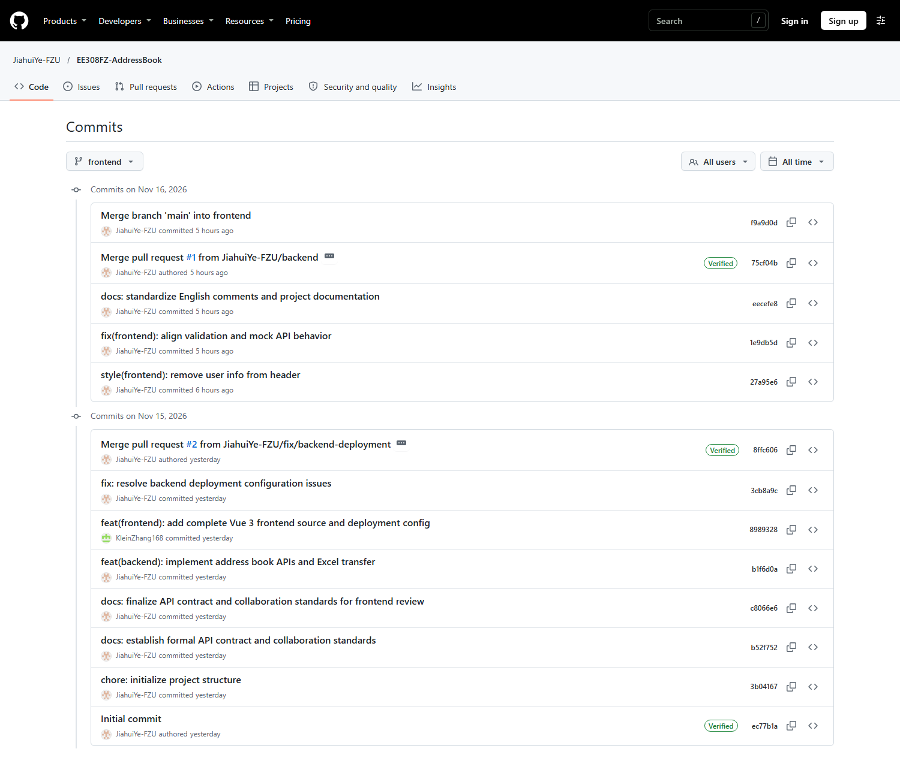

*Figure 1 — Commit history of the `frontend` branch. The frontend source was imported in a feature commit, then integrated with the backend branch through pull requests.*

### 3.2 Contributor statistics

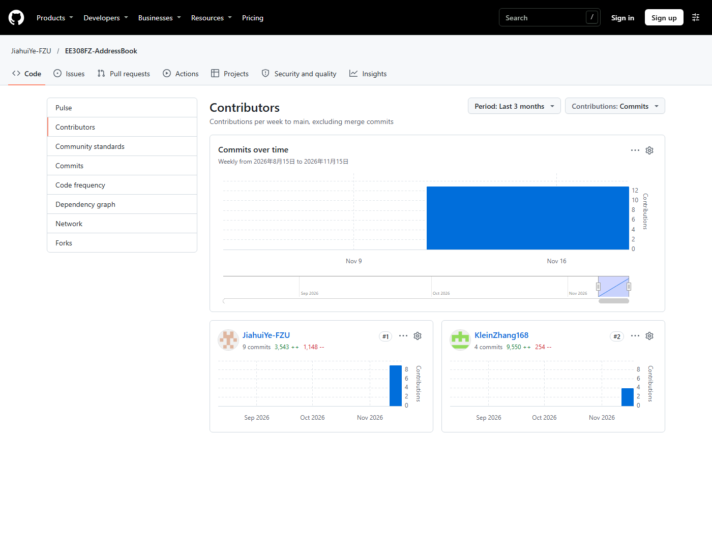

*Figure 2 — GitHub Insights → Contributors (commits to `main`, merge commits excluded).*

| Contributor | Historical Role in Project | Commits | Lines added | Lines deleted |
| --- | --- | ---: | ---: | ---: |
| Ye Jiahui (`JiahuiYe-FZU`) | Backend architecture & integration | 9 | 3,543 | 1,148 |
| Zhang Sufang (`KleinZhang168`) | Frontend UI/UX & components | 4 | 9,550 | 254 |
| Fatespur (`Fatespur`) | Refactoring, Chinese localization & maintenance | - | - | - |

*Statistics captured on 2026-11-16 23:20 (UTC+8) at commit `3938164`; merge commits are excluded.*

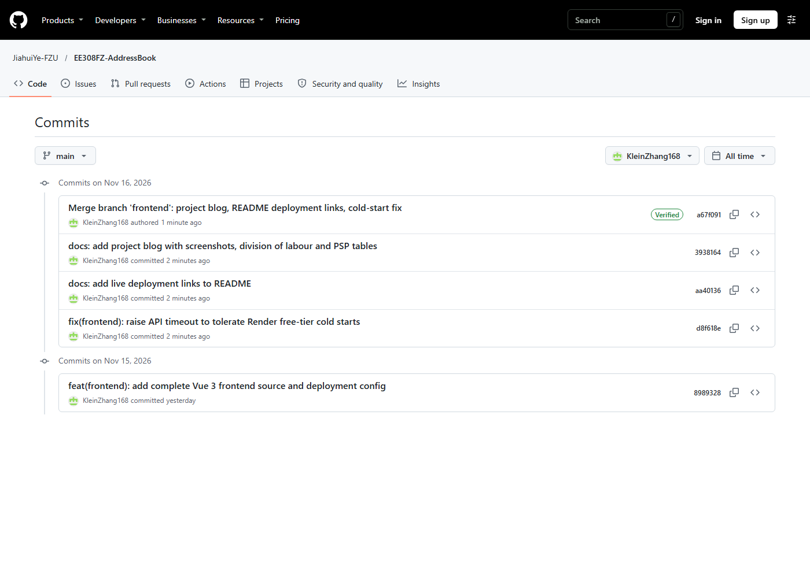

*Figure 3 — Commits authored by the frontend developer (Zhang Sufang).*

**Repository totals:** `main` contains both modules and the merge commits of pull requests; four branches exist (`main`, `frontend`, `backend`, `fix/backend-deployment`). The commit counts in the table above are the non-merge commits reported by GitHub Insights.

> Note on commit granularity: the 41-file frontend module was originally delivered as one large commit
> (`feat(frontend): add complete Vue 3 frontend source and deployment config`). Follow-up work — the cold-start
> timeout fix, deployment links in the README, and this article — is committed separately, which makes the
> per-contributor history a better reflection of the ongoing work. This was one of the process lessons of the
> project (see Section 8).
> per-contributor history a better reflection of the ongoing work. This was one of the process lessons of the
> project (see Section 8).

---

## 4. Functional Implementation Ideas (Frontend)

### 4.1 Technical stack and architecture

- **Vue 3 (Composition API, `<script setup>`)** + **Vite 7** + **Element Plus** + **Vue Router** + **Axios**.
- Three-layer structure: **views** (`ContactListView`, `SettingsView`) → **components** (layout, list, detail,
  dialogs, common widgets) → **api / stores / utils**.
- A single reactive store (`stores/contactStore.js`) owns list data, filters, pagination, selection and detail
  state. Views stay declarative; components receive props and emit events.

### 4.2 API layer that survives both Mock and real backend

`api/request.js` creates one Axios instance:

- `baseURL = import.meta.env.VITE_API_BASE_URL || '/api/v1'` — relative path in development (Vite proxy),
  absolute URL on the deployed Static Site.
- A response interceptor unwraps the contract envelope `{ code, message, data }`, so every component works with
  plain data objects.
- Errors are normalised once: `error.code`, `error.errorCode`, `error.details`, plus a single toast. Blob
  responses (Excel export) bypass the unwrapping so the file can be downloaded directly.
- `api/contacts.js` switches between `api/mock.js` and the real endpoints with `VITE_USE_MOCK`. Production
  builds default to the real API, so a deployed build can never silently fall back to demo data.

This Mock layer was the key to parallel development: the UI was fully usable before the backend existed, and the
same components later ran against Flask without changes.

### 4.3 List, search, filtering and pagination

- Debounced search (300 ms) over name, notes, phone numbers and emails; previous requests are cancelled with
  `AbortController` so slow responses cannot overwrite newer results.
- Group filter with live count badges, favourites-only switch, page sizes 10/20/50, and client-side sorting of
  the current page.
- Optimistic favourite toggling (`PATCH /contacts/{id}/favorite`) with rollback and an error toast if the
  request fails.

### 4.4 Contact editor and field-level validation

- Create/edit dialog with dynamic rows for phones, emails, social accounts and addresses, label presets that can
  be searched and created, and mutually exclusive *primary* marks.
- The backend returns `400 VALIDATION_ERROR` with a `details` object; the dialog maps each entry back to the
  exact field/row, so a bad phone number highlights that row instead of showing a generic error.
- Dirty-state check before closing, `Esc` to dismiss, and focus restoration for accessibility.

### 4.5 Excel import / export

- **Export** downloads the filtered set as `.xlsx` (blob + `Content-Disposition` filename parsing).
- **Import** provides drag-and-drop, `.xlsx` and 10 MB checks, upload progress, cancellation, and a result panel
  with success/failure counts; failed rows can be exported as a CSV.
- The import template is shipped in `public/templates/` so the download works on the deployed site.

### 4.6 Responsive layout and UX details

- ≥ 1280 px: three columns (sidebar, list, persistent detail panel).
- 1024–1279 px: detail becomes a right-side drawer.
- 768–1023 px: icon-only sidebar, condensed 5-column table, overflow menu.
- Skeleton screens on first load, empty/error states with retry, keyboard shortcuts (`Ctrl/⌘ + K`, `Esc`,
  `Enter`), and design tokens (`styles/tokens.css`) with Element Plus overrides.

### 4.7 Deployment adaptation (frontend side)

- Build-time configuration: `VITE_API_BASE_URL` and `VITE_USE_MOCK` are injected on Render, so the same source
  builds for local development and production.
- SPA routing: the Static Site rewrites `/*` to `/index.html`, otherwise refreshing `/settings` returns 404.
- Cold starts: the free backend instance sleeps and needs 30–60 s to wake up. The Axios timeout was raised to
  60 s with an explicit "service is starting" message, so the first visit on another machine no longer shows an
  empty list.

---

## 5. Screenshots of the Running System

Deployed application (real Flask + SQLite backend, not Mock data):

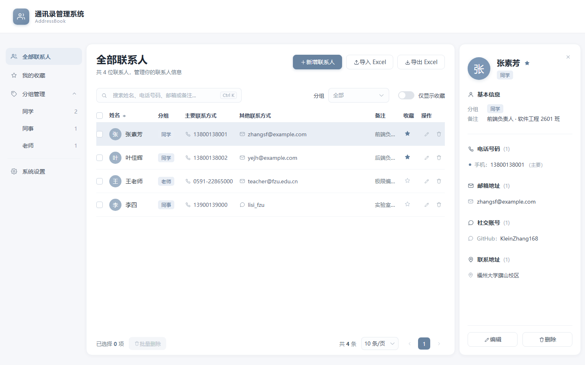

*Figure 4 — `https://contacthub-web.onrender.com` with four contacts loaded from the live API.*

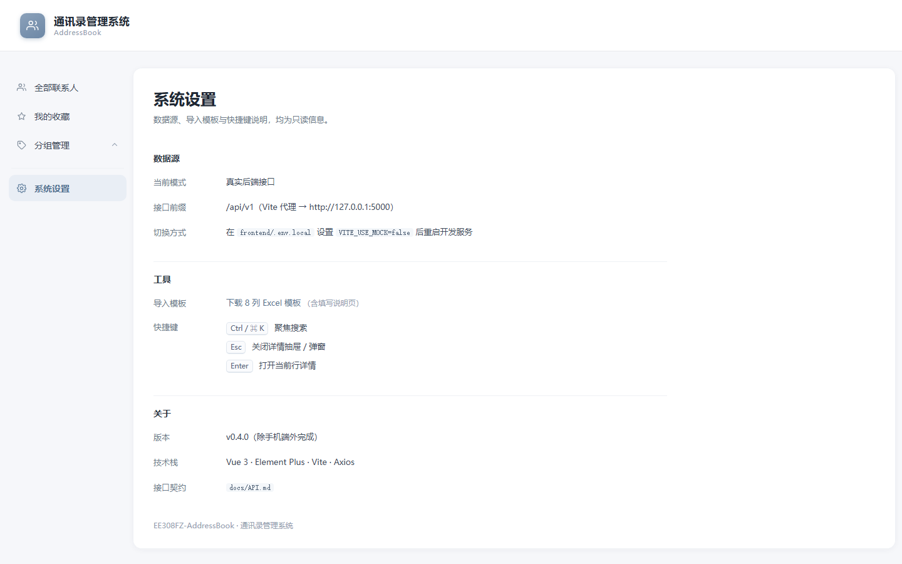

*Figure 5 — Settings page, reachable directly after the SPA rewrite was configured.*

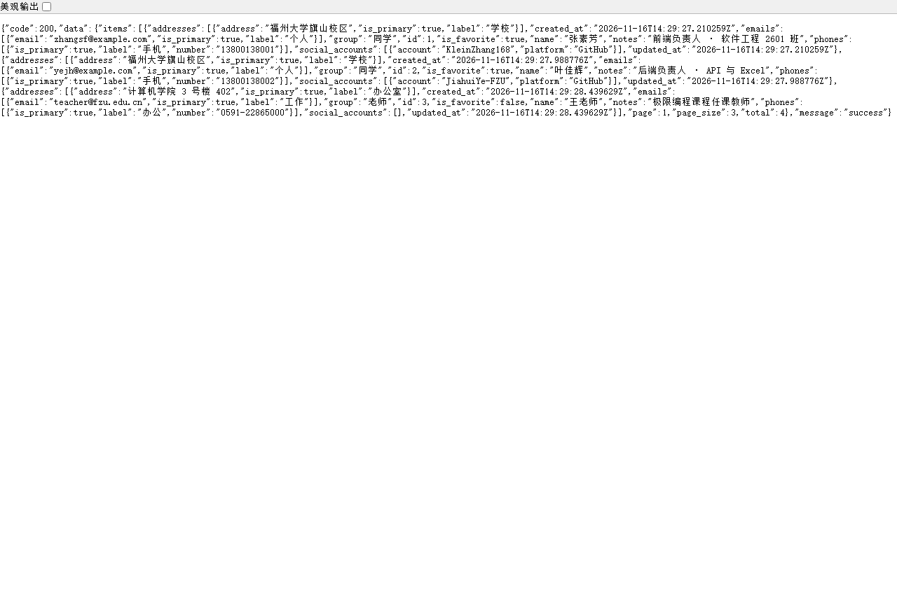

*Figure 6 — The live backend response (`GET /api/v1/contacts`), showing the contract envelope and nested
contact attributes.*

Feature details (captured during acceptance testing):

| Create dialog with dynamic rows | Field-level validation errors |
| --- | --- |
| 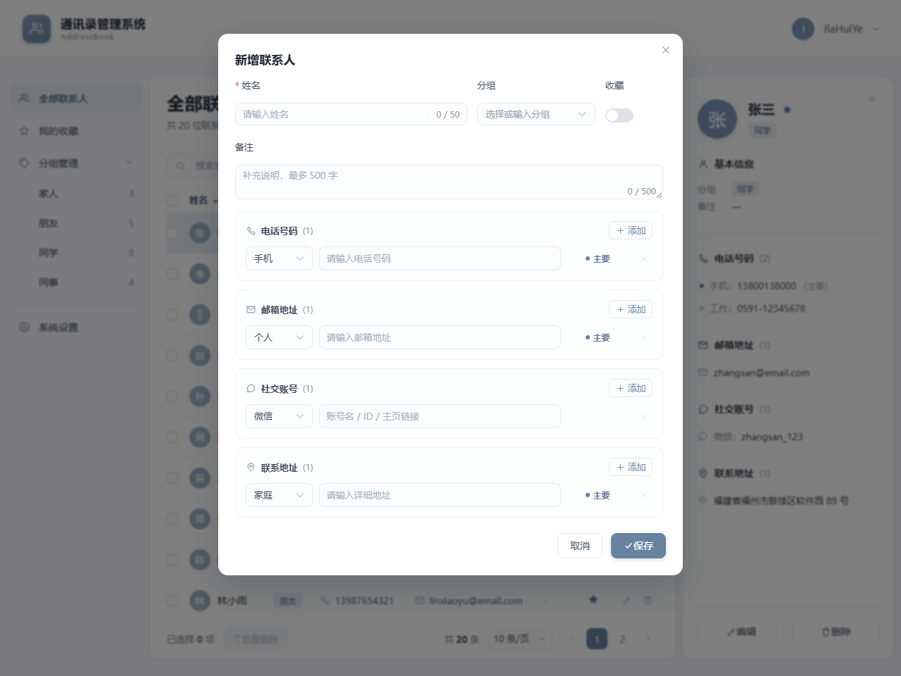 | 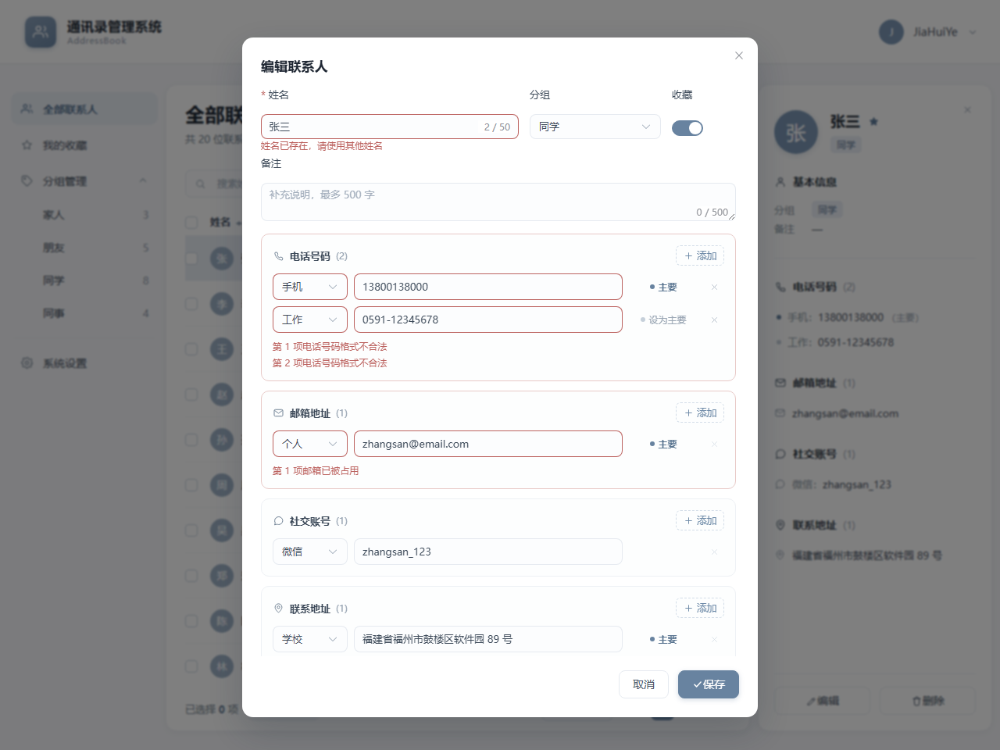 |

| Excel import result | Tablet layout (768 px) |
| --- | --- |
| 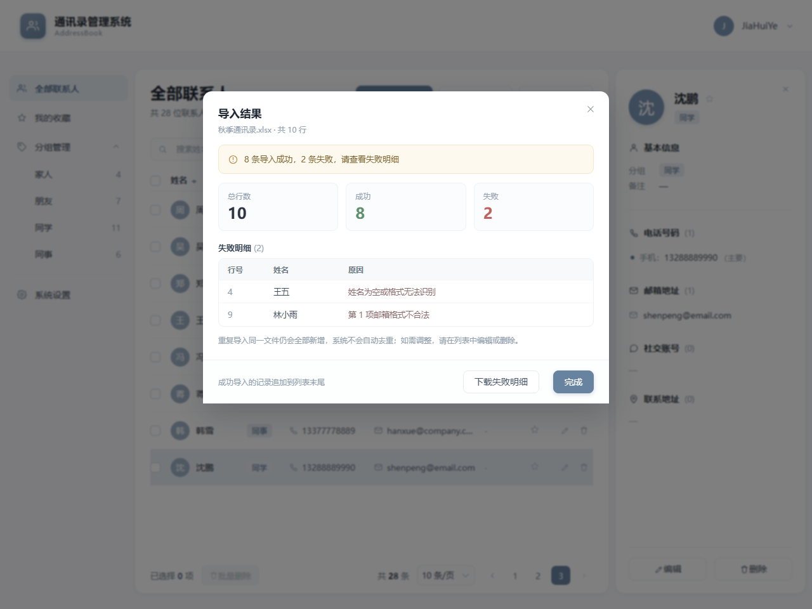 | 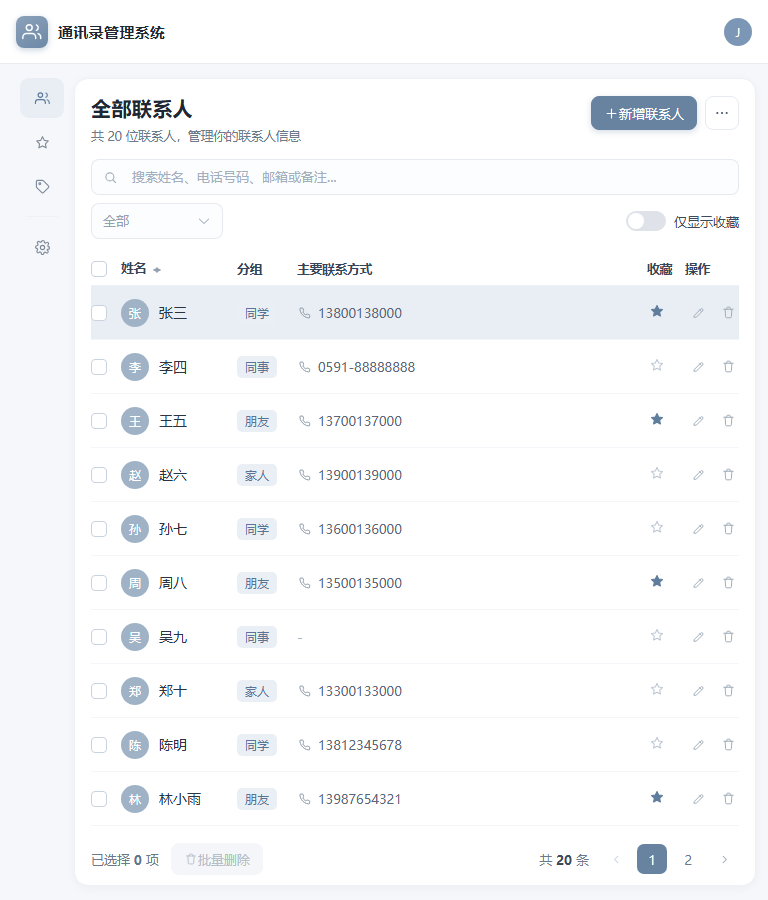 |

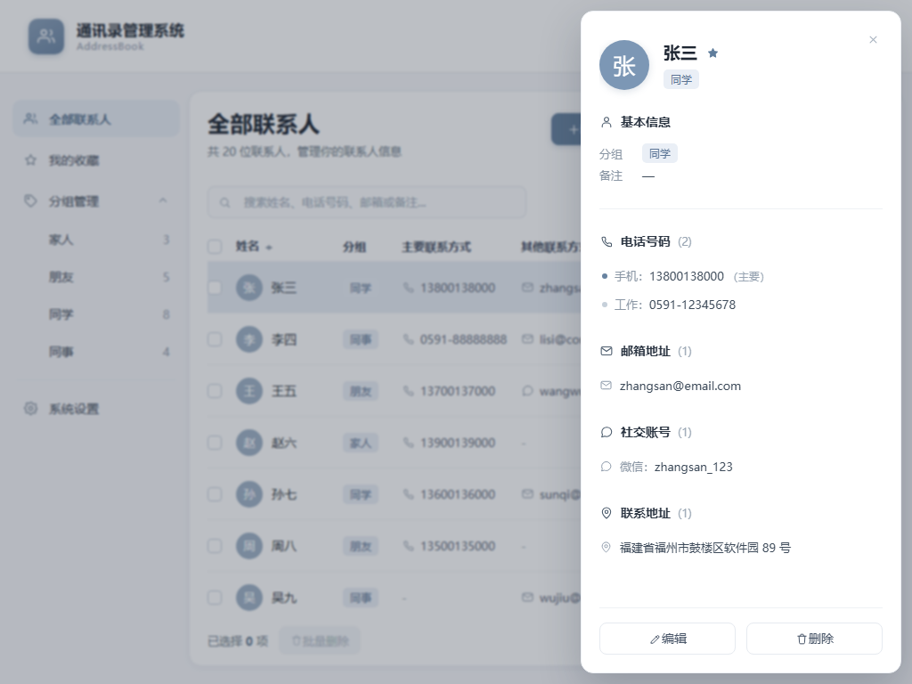

*Figure 7 — Detail panel as a drawer between 1024 and 1279 px.*

---

## 6. Demo Video

> **Video link:** _[paste the recording link here — e.g. Bilibili / OneDrive / YouTube]_

Suggested 3-minute recording script (covers every graded feature):

| Time | Action |
| --- | --- |
| 0:00–0:15 | Open <https://contacthub-web.onrender.com>, show the contact list (warm up the free instance first) |
| 0:15–0:40 | Search by keyword, filter by group, toggle *favourites only*, change page size |
| 0:40–1:15 | Create a contact with two phones, one email, one social account and one address; demonstrate validation errors, then save |
| 1:15–1:40 | Edit the contact, toggle the favourite star, delete with confirmation |
| 1:40–2:05 | Export to Excel and open the downloaded file |
| 2:05–2:35 | Download the import template, fill two rows, upload, show the success/failure statistics |
| 2:35–2:50 | Resize the window to 1024 px and 768 px to show the responsive layout |
| 2:50–3:00 | Refresh the page to show persistence, then open `/settings` directly (SPA routing) |

---

## 7. Engineering Phase & Time Metrics

### 7.1 Zhang Sufang — Frontend Phase Metrics

| Engineering Phase | Stage | Time (h) | % |
| --- | --- | ---: | ---: |
| Planning | Estimate | 1.0 | 2.6 |
| Development | Analysis (API contract, UI spec) | 2.5 | 6.6 |
| Development | Design spec (UI design docs, 3 phases) | 4.0 | 10.5 |
| Development | Design review | 1.0 | 2.6 |
| Development | Coding standard | 0.5 | 1.3 |
| Development | Design (component tree, tokens) | 5.0 | 13.2 |
| Development | Coding (33 components / views / utils) | 15.0 | 39.5 |
| Development | Code review | 2.0 | 5.3 |
| Development | Test plan (acceptance checklist) | 1.0 | 2.6 |
| Development | Testing (manual, build, deployment) | 5.0 | 13.2 |
| Record Time Spent | Time log | 1.0 | 2.6 |
| Postmortem | Summary | 0.5 | 1.3 |
| **Total** | | **38.0** | **100** |

### 7.2 Ye Jiahui — Backend Phase Metrics

| Engineering Phase | Stage | Time (h) | % |
| --- | --- | ---: | ---: |
| Planning | Estimate | 0.5 | 1.6 |
| Development | Analysis (API contract) | 2.0 | 6.3 |
| Development | Design spec (schema, endpoints) | 4.0 | 12.5 |
| Development | Design review | 1.0 | 3.1 |
| Development | Coding standard | 0.5 | 1.6 |
| Development | Design (app factory, modules) | 3.5 | 10.9 |
| Development | Coding (Flask API, Excel service) | 10.0 | 31.3 |
| Development | Code review | 1.5 | 4.7 |
| Development | Test plan | 1.0 | 3.1 |
| Development | Testing (65 pytest cases) | 5.0 | 15.6 |
| Deployment | WSGI, gunicorn, environment configuration | 2.0 | 6.3 |
| Record Time Spent | Time log | 0.5 | 1.6 |
| Postmortem | Summary | 0.5 | 1.6 |
| **Total** | | **32.0** | **100** |

---

## 8. Cooperation Difficulties and How We Resolved Them

1. **Branch strategy disagreement.** We first created an integration branch (`dev`) containing both modules, but
   the team preferred per-module branches with pull requests. *Resolution:* the frontend work was rebased onto the
   `frontend` branch, `dev` was deleted, and integration now happens through PRs (`frontend` → `main`,
   `backend` → `main`).

2. **The Excel template silently disappeared from the repository.** The root `.gitignore` contained `*.xlsx`,
   which also excluded `frontend/public/templates/contacts-import-template.xlsx`; the deployed site would have
   returned 404 for the template download. *Resolution:* negation rules
   (`!frontend/public/templates/*.xlsx`) plus a `git ls-files` check in the release checklist.

3. **Cross-origin calls between two Render services.** A Static Site and a Web Service live on different
   domains, so the browser blocked API requests. *Resolution:* the backend reads allowed origins from the
   `CORS_ORIGINS` environment variable, and the frontend receives the API base URL at build time via
   `VITE_API_BASE_URL`.

4. **"My contacts are invisible on my teammate's computer."** The free instance sleeps after 15 minutes and needs
   30–60 s to wake up, while the frontend timeout was 15 s, so the first visit on another machine failed and
   showed an empty list. *Resolution:* timeout raised to 60 s with a clear message; the data itself was always
   shared server-side.

5. **The backend could not start on Render.** The original entry point bound `127.0.0.1:5000` and had no WSGI
   target. *Resolution:* added `backend/wsgi.py`, added `gunicorn` to the requirements (non-Windows only), and
   moved the database path and CORS origins to environment variables.

6. **Free-tier storage is ephemeral.** Redeploys reset the SQLite file, so demo data disappeared after each
   deployment. *Resolution:* documented clearly, demo data re-imported before acceptance, and the persistent-disk
   option (paid plan, `/var/data`) documented in `docs/DEPLOY_RENDER.md`.

7. **One giant frontend commit.** Delivering 41 files in a single commit made the contribution graph look
   lopsided and made review harder. *Resolution:* follow-up work is now committed incrementally, and the lesson
   is recorded here.

8. **Mock/real parity.** Validation messages and edge cases drifted between the mock layer and Flask. *Resolution:*
   the mock was aligned with the contract (`docs/API.md`) and a review commit fixed the remaining differences.

---

## 9. Reflections

The most valuable part of this project was not any single feature but the **contract-first workflow**: writing
`docs/API.md` and a mock layer before the backend existed let both of us work in parallel, and integration took
hours instead of days. The deployment step also taught us that "it works on my machine" is a weak claim: free
cloud instances sleep, files disappear, ports must be bound to `0.0.0.0`, and cross-origin rules are real. Every
one of those issues is now written down in the deployment guide so the next run is boring — which is exactly what
a deployment should be.

---

## 10. Appendix & Authorization Status

- API contract: [docs/API.md](API.md)
- Coding standards: [docs/CODING_STANDARDS.md](CODING_STANDARDS.md)
- Deployment guide: [docs/DEPLOY_RENDER.md](DEPLOY_RENDER.md)
- Acceptance checklist: [docs/ACCEPTANCE.md](ACCEPTANCE.md)

### Authorization & Maintainer License Clearance Checklist
ContactHub is an engineering evolution of the initial academic pair-programming repository `EE308FZ-AddressBook`. 
The upstream project did not include an explicit `LICENSE` file. Because this repository contains code authored by different contributors, rights attribution must be handled rigorously.

Until the following manual clearances are obtained, **this project does not claim that MIT relicensing is fully effective across all historical assets**:

| Item | Covered Assets | Original Rights Holder | Clearance Scope | Current Status |
| :--- | :--- | :--- | :--- | :---: |
| **Maintainer Codebase** | `backend/` application logic, test suites, CI workflows, scripts, docs & refactoring | **Ye Jiahui / Fatespur** (same maintainer, different GitHub accounts) | Maintainer confirms and grants MIT license across his historical and evolution codebase | 🟢 Authorized (Maintainer) |
| **Frontend Codebase** | `frontend/src/`, components, styles authored during pair programming | **Zhang Sufang** ([@KleinZhang168](https://github.com/KleinZhang168)) | Affirm agreement to license historical frontend code under MIT with rights to modify and redistribute | 🟡 Pending manual confirmation (Issue / Email / CLA) |

> **Rights Attribution & Compliance Notes:**
> 1. `JiahuiYe-FZU` and `Fatespur` represent the same maintainer's different GitHub accounts and are not redundantly counted as independent parties requiring authorization.
> 2. For codebase assets authored by the other contributor (**Zhang Sufang**), in the absence of explicit authorization evidence, **the project strictly maintains the status of authorization incomplete / pending**, and never marks them as authorized unilaterally.
> 3. All original commit histories and author attributions are strictly and faithfully preserved without rewrite.
