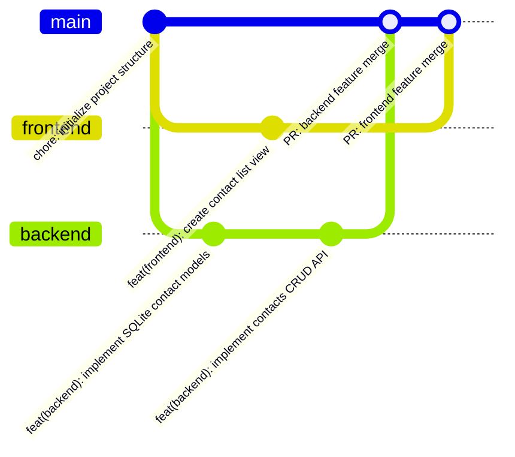

# EE308FZ-AddressBook Development Standards & Collaboration Guidelines

> [!IMPORTANT]
> **Scope**: All team members of the EE308FZ Software Engineering Pair Project.
> **Roles & Ownership**:
> - **Backend**: Python Flask + SQLite + openpyxl, responsible for database persistence, RESTful APIs, and Excel import/export processing.
> - **Frontend**: Vue 3 + JavaScript + Element Plus + Vite, responsible for UI/UX interaction, component hierarchy, client state, and API integration.
>
> This document establishes clean, concise, and consistent standards to maintain code quality and delivery efficiency throughout the pair software engineering project.

---

## Table of Contents

- [1. Collaboration Principles](#1-collaboration-principles)
- [2. Code Style & Conventions](#2-code-style--conventions)
  - [2.1 Frontend Conventions (Vue 3 / JavaScript)](#21-frontend-conventions-vue-3--javascript)
  - [2.2 Backend Conventions (Python / Flask)](#22-backend-conventions-python--flask)
- [3. Naming Convention Matrix](#3-naming-convention-matrix)
- [4. Git Workflow & Branch Strategy](#4-git-workflow--branch-strategy)
- [5. Git Commit Guidelines](#5-git-commit-guidelines)
- [6. Pull Request (PR) & Code Review Guidelines](#6-pull-request-pr--code-review-guidelines)
- [7. Standards Alignment & Technical Decisions](#7-standards-alignment--technical-decisions)

---

## 1. Collaboration Principles

1. **Contract-First Principle**:
   - All API endpoints, HTTP methods, request bodies, and response structures are defined exclusively in [docs/API.md](API.md).
   - Neither developer may modify field names, field types, or HTTP status codes unilaterally without mutual agreement.
   - Any interface adjustments must be updated and confirmed in `docs/API.md` before writing implementation code.
2. **Environment Isolation & Dev Proxy**:
   - Frontend local server port: `5173` (Vite default).
   - Backend local server port: `5000` (Flask default).
   - Unified API routing prefix: `/api/v1`.
   - Local cross-origin requests are handled via Vite reverse proxy in development, eliminating browser CORS issues.
3. **Independent Parallel Development**:
   - The frontend implements UI views and mock data handlers conforming strictly to `docs/API.md`.
   - The backend validates endpoints and Excel handling via automated tests to guarantee 100% contract compliance.

---

## 2. Code Style & Conventions

### 2.1 Frontend Conventions (Vue 3 / JavaScript)
- **Paradigm**: Vue 3 **Composition API** with `<script setup>`. Options API is disallowed in newly authored components.
- **Indentation & Formatting**: **2 spaces** indentation; tabs are forbidden. No trailing whitespace.
- **Quotes**: Single quotes `'` for JavaScript strings; double quotes `"` for HTML / Vue template attributes.
- **Network Requests**: Encapsulated in Axios instances (`src/api/request.js`) providing unified `baseURL: '/api/v1'`, response data unwrapping, and Element Plus `ElMessage` notification handling.

### 2.2 Backend Conventions (Python / Flask)
- **Code Standards**: Adhere strictly to **PEP 8**.
- **Indentation**: **4 spaces** indentation; never mix tabs and spaces. Line length recommended within 88–100 characters.
- **Type Hints**: Type annotations are recommended for public functions and route controllers to improve maintainability.
- **Docstrings & Comments**: Concise docstrings describing purpose, arguments, and return types. Code comments must be written in English.
- **Global Exception Handling**: Global error handlers (`@app.errorhandler`) capture validation errors and 4xx/5xx exceptions, ensuring unified JSON error bodies matching the contract.

---

## 3. Naming Convention Matrix

| Target Element | Convention | Example | Notes |
| :--- | :--- | :--- | :--- |
| **API Path (REST)** | kebab-case / Plural nouns | `/api/v1/contacts`, `/contacts/export` | Lowercase hyphens with unified prefix |
| **JSON Fields** | **`snake_case`** | `is_favorite`, `social_accounts`, `created_at` | **Mandatory snake_case across all API contracts** |
| **Vue Component Files** | PascalCase | `ContactList.vue`, `ContactDialog.vue` | Multi-word PascalCase |
| **JS Variables / Functions** | **`camelCase`** | `contactList`, `fetchContacts()`, `isLoading` | Nouns for variables, verbs for functions |
| **JS Constants** | UPPER_SNAKE_CASE | `API_TIMEOUT`, `DEFAULT_PAGE_SIZE` | All uppercase with underscores |
| **Python Files / Modules** | snake_case | `contact_service.py`, `excel.py` | Lowercase with underscores |
| **Python Classes** | PascalCase | `ContactModel`, `MockApiError` | PascalCase |
| **Python Variables / Functions**| **`snake_case`** | `contact_id`, `get_contact_list()` | Lowercase with underscores |
| **Database Tables / Columns** | snake_case | `contacts`, `phone_numbers`, `is_favorite` | Lowercase with underscores |

---

## 4. Git Workflow & Branch Strategy



### 4.1 Branch Architecture
- **`main` (Stable Trunk)**:
  - Protected release branch containing thoroughly verified code.
  - Direct pushes to `main` are prohibited.
  - All changes must merge via Pull Requests following peer review.
- **`frontend` (Frontend Development)**: Primary branch for frontend implementation and UI assets.
- **`backend` (Backend Development)**: Primary branch for Flask API, database models, and Excel handlers.
- **Feature Branches**:
  - `feat/frontend-<feature-name>`
  - `feat/backend-<feature-name>`
  - `fix/<bug-name>`

### 4.2 Pair Collaboration Principles
- Each developer owns their respective branch to prevent concurrent modifications to shared files.
- Verify tests and local builds before pushing commits.

---

## 5. Git Commit Guidelines

Commits must follow the **[Conventional Commits](https://www.conventionalcommits.org/)** specification:

```text
<type>(<scope>): <subject>
```

### 5.1 Commit Types
- **`feat`**: New feature (e.g. contact list view, Excel export)
- **`fix`**: Bug fix
- **`docs`**: Documentation changes only (e.g. API contract updates)
- **`style`**: Code formatting (spaces, semicolons; no business logic change)
- **`refactor`**: Code refactoring (neither fixes a bug nor adds a feature)
- **`test`**: Adding or modifying tests
- **`chore`**: Build tool configuration, dependency updates, directory adjustments

### 5.2 Examples
```bash
feat(backend): implement address book APIs and Excel transfer
feat(frontend): add complete Vue 3 frontend source and deployment config
fix(excel): fix formula cell rejection during import
docs: update API contract for xlsx export and import
style(frontend): remove user info from header
```

---

## 6. Pull Request (PR) & Code Review Guidelines

### 6.1 PR Process
1. **Creating a PR**:
   - Open a PR from the development branch (`frontend` / `backend`) targeting `main`.
   - The PR title must follow Conventional Commits format (e.g. `feat(backend): implement address book APIs and Excel transfer`).
2. **PR Description Checklist**:
   ```markdown
   ## Type of Change
   - [ ] Feature (feat)
   - [ ] Bug fix (fix)
   - [ ] Documentation (docs)
   - [ ] Chore / Refactoring (chore/refactor)

   ## Summary of Changes
   - Describe what this PR implements...

   ## Verification
   - [ ] Local build / tests pass without errors
   - [ ] Strict compliance with docs/API.md
   - [ ] Edge cases and error handling validated

   ## Impact & Coordination
   - Notes on configuration changes or migration requirements...
   ```
3. **Mandatory Peer Review**:
   - Merging requires review and approval from the partner developer.
   - Key review items: adherence to API contract, code readability, absence of unhandled exceptions, and comment language standards.

---

## 7. Standards Alignment & Technical Decisions

### 7.1 Baseline Standards
- Frontend: Vue 3 + JavaScript + Element Plus + Vite.
- Backend: Python Flask + SQLite + openpyxl.
- Ports: Frontend `5173` / Backend `5000`, unified API prefix `/api/v1`, Vite dev proxy.
- Naming: `snake_case` for all JSON payloads and database columns; `camelCase` for JavaScript variables; `snake_case` for Python.
- Git workflow: Separate `frontend` and `backend` development branches targeting `main` via PRs.

### 7.2 Finalized Technical Agreements
1. **Frontend Formatting**: 2-space indentation, single quotes, no unnecessary semicolons.
2. **Layout & UI Pattern**: Responsive three-column layout (sidebar + table + detail drawer).
3. **API Contract Enforcement**: Strict 8-field full replacement for `PUT /api/v1/contacts/{id}` returning HTTP 400 when editable fields are omitted.
