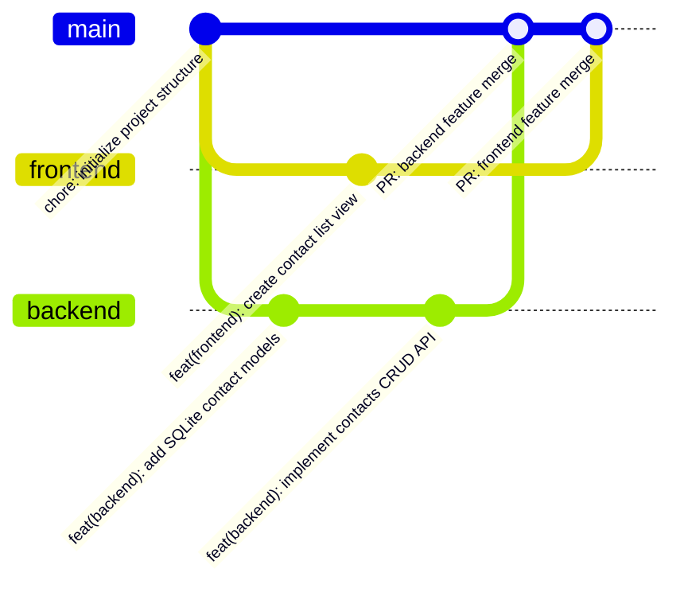

# EE308FZ-AddressBook 开发规范与团队协作准则

> [!IMPORTANT]
> **适用范围**：EE308FZ 双人软件工程作业团队全体成员。  
> **团队分工**：
> - **后端**：Python Flask + SQLite + openpyxl，负责数据存储模型、RESTful 接口及 Excel 解析。
> - **前端**：Vue 3 + JavaScript + Element Plus + Vite，负责 UI 交互、组件设计及接口联调。
> 
> 本文档是保证双人独立开发后能够无缝集成与顺畅联调的基础协作基石。

---

## 目录

- [一、前后端协作基本准则](#一前后端协作基本准则)
- [二、代码风格与开发规范](#二代码风格与开发规范)
  - [1. 前端规范 (Vue 3 / JavaScript)](#1-前端规范-vue-3--javascript)
  - [2. 后端规范 (Python / Flask)](#2-后端规范-python--flask)
- [三、命名规则矩阵](#三命名规则矩阵)
- [四、Git 工作流与分支管理](#四git-工作流与分支管理)
- [五、Git Commit 提交规范](#五git-commit-提交规范)
- [六、Pull Request（PR）与代码审查规范](#六pull-requestpr与代码审查规范)
- [七、规范确认状态与待确认事项](#七规范确认状态与待确认事项)

---

## 一、前后端协作基本准则

1. **契约优先原则（Contract-First）**：
   - 所有的 API 接口路径、请求方法、请求 Body 结构、响应 Body 结构以 [docs/API.md](API.md) 为唯一依据。
   - 严禁任何一方在未沟通的情况下私自修改字段名、字段类型或 HTTP 状态码。
   - 如遇接口字段无法满足需求，必须**先更新 API.md 文档并经双方确认**，再进入代码实现。
2. **环境隔离与联调基准**：
   - 前端本地服务端口：`5173`（Vite 默认）。
   - 后端本地服务端口：`5000`（Flask 默认）。
   - 开发期跨域统一采用前端 Vite 反向代理（Proxy）转发至 `/api/v1`，消除浏览器 CORS 问题。
3. **Mock 与独立开发**：
   - 在后端完成真实接口前，前端可根据 `docs/API.md` 中的响应示例进行本地 Mock 开发，保证开发进度解耦。
   - 后端需针对 API 编写接口单元测试，保证接口输出格式与契约百分之百吻合。

---

## 二、代码风格与开发规范

### 1. 前端规范 (Vue 3 / JavaScript)
- **开发范式**：统一使用 Vue 3 **Composition API** 配合 `<script setup>` 语法，禁止在新建组件中使用 Options API。
- **缩进与排版**：使用 **2 空格缩进**，禁止使用 Tab 制表符。行末禁止留有无意义的空格。
- **引号规则**：JavaScript 代码优先使用单引号 `'`，JSX / Vue Template 属性使用双引号 `"`。
- **分号约定**：推荐遵循统一的无分号（no-semi）或标准 Prettier 风格，但必须在整个前端项目保持统一。
- **组件结构顺序**：单文件组件（SFC）统一按照标准顺序排列：
  ```vue
  <template>
    <!-- 模板结构 -->
  </template>

  <script setup>
  // 逻辑代码与状态
  </script>

  <style scoped>
  /* 局部样式 */
  </style>
  ```
- **网络请求封装**：前端必须统一使用 Axios 实例封装（如 `src/api/request.js`），统一处理 `baseURL`、请求超时、响应解包以及 Element Plus 的 `ElMessage` 错误提示。

### 2. 后端规范 (Python / Flask)
- **代码规范**：严格遵循 **PEP 8** 编码规范。
- **缩进与排版**：使用 **4 空格缩进**，严禁混用 Tab 与空格。单行最大字符数建议控制在 88~100 字符。
- **类型提示 (Type Hints)**：关键函数与路由控制器建议标明参数类型与返回类型，提升可维护性。
- **注释与 Docstring**：所有公共函数、Service 类和数据模型需包含简要 Docstring，说明功能、参数与返回值。
- **异常拦截**：后端必须配置全局统一错误处理器（`@app.errorhandler`），捕获自定义业务异常与 4xx/5xx 错误，保证返回的 JSON 结构与契约中的错误格式一致。

---

## 三、命名规则矩阵

| 目标类型 | 命名范式 | 示例 | 补充说明 |
| :--- | :--- | :--- | :--- |
| **API 路径 (REST)** | kebab-case / 名词复数 | `/api/v1/contacts`, `/contacts/export` | 全小写短横线，统一前缀 |
| **JSON 请求/响应字段** | **`snake_case`** | `is_favorite`, `social_accounts`, `created_at` | **前后端交互强制一律小写下划线** |
| **前端 Vue 组件文件** | PascalCase | `ContactList.vue`, `ContactDialog.vue` | 必须为大驼峰多词组合 |
| **前端 JS 文件 / 模块** | kebab-case / camelCase | `contact-api.js`, `formatDate.js` | 统一小写或小驼峰 |
| **JS 变量 / 函数名** | camelCase | `contactList`, `handleEdit()`, `isLoading` | 变量为名词，函数动词开头 |
| **JS 常量** | UPPER_SNAKE_CASE | `API_TIMEOUT`, `DEFAULT_PAGE_SIZE` | 全大写下划线 |
| **Python 文件 / 模块** | snake_case | `contact_service.py`, `models.py` | 全小写下划线 |
| **Python 类名** | PascalCase | `ContactModel`, `ContactService` | 大驼峰 |
| **Python 变量 / 函数名** | snake_case | `contact_id`, `get_contact_list()` | 全小写下划线 |
| **数据库表名 / 字段名** | snake_case | `contacts`, `phone_numbers`, `is_favorite` | 全小写下划线复数 |

---

## 四、Git 工作流与分支管理



### 1. 分支架构说明
- **`main`（稳定主分支）**：
  - 受保护分支，对应稳定、可运行的代码版本。
  - **严禁直接向 `main` 分支执行 `git push`**。
  - 所有改动必须通过 Pull Request 并经对方 Code Review 确认后方可合入。
- **`frontend`（前端开发分支）**：
  - 前端开发的主线分支，前端人员负责日常维护与推进。
- **`backend`（后端开发分支）**：
  - 后端开发的主线分支，后端人员负责日常维护与推进。
- **特性分支（Feature Branches）**：
  - 当开发特定独立功能时，从对应分支拉出：
    - 前端特性分支：`feat/frontend-<feature-name>`
    - 后端特性分支：`feat/backend-<feature-name>`
    - 缺陷修复分支：`fix/<bug-name>`

### 2. 双人协作提交原则
- 各自负责对应分支，避免在同一文件的同一区域并发修改造成不必要的冲突。
- 保证本地提交前通过基本语法校验与单元测试。

---

## 五、Git Commit 提交规范

必须采用 **[Conventional Commits](https://www.conventionalcommits.org/)** 标准格式，便于自动生成变更日志并追踪版本演进：

```text
<type>(<scope>): <subject>
```

### 1. 结构说明
- **`<type>`（必填）**：
  - `feat`: 新增功能（如添加联系人列表、支持 Excel 导出）
  - `fix`: 修复 Bug 或缺陷
  - `docs`: 仅文档改动（如更新 API 契约、编码规范）
  - `style`: 代码格式调整（空格、分号、格式化，不影响代码逻辑）
  - `refactor`: 代码重构（无新增功能亦无修复 Bug）
  - `test`: 增加或修改测试
  - `chore`: 构建配置、依赖管理、目录架构变动
- **`<scope>`（选填）**：
  - 如 `(frontend)`, `(backend)`, `(contact)`, `(excel)`, `(docs)` 等。
- **`<subject>`（必填）**：
  - 简短精炼描述改动内容（中文或英文），首字母小写，句末不加句号。

### 2. 规范示例
```bash
feat(backend): add contact multi-phone and email models
feat(frontend): implement contact card and tag display
fix(excel): fix openpyxl phone number formatting issue
docs: update API contract for social accounts
chore: add element-plus and vite proxy config
```

---

## 六、Pull Request（PR）与代码审查规范

### 1. PR 流程要求
1. **创建 PR**：
   - 特性开发完毕后，向对应的主干分支（`frontend` / `backend`）或向 `main` 发起 PR。
   - PR 标题必须符合 Commit 规范风格，如 `feat(backend): implement RESTful API for contacts`。
2. **PR 描述模板**：
   ```markdown
   ## 变更类型
   - [ ] 新功能 (feat)
   - [ ] 缺陷修复 (fix)
   - [ ] 文档更新 (docs)
   - [ ] 重构或依赖 (chore/refactor)

   ## 变更内容简述
   - 说明本次 PR 实现的具体内容...

   ## 自测情况
   - [ ] 本地运行无报错
   - [ ] API 契约已严格对照 docs/API.md
   - [ ] 边界情况与异常处理已自测

   ## 影响范围与需对方配合事项
   - 是否涉及 API 变更或配置改动...
   ```
3. **强制双人互审（Peer Review）**：
   - 任何合并必须由另一位成员（Reviewer）进行审查并批准（Approve）。
   - Reviewer 重点审查：是否违背 API 契约、代码可读性、是否存在未处理的异常与资源泄露。

---

## 七、规范确认状态与待确认事项

### 1. 【已确认规范】
- [x] 前端技术栈确认：Vue 3 + JavaScript + Element Plus + Vite。
- [x] 后端技术栈确认：Python Flask + SQLite + openpyxl。
- [x] 开发端口（前端 `5173` / 后端 `5000`）及反向代理联调方案。
- [x] JSON 字段全部统一为 `snake_case`。
- [x] 确立“契约优先”准则，修改接口必须先改 API.md 并双方同步。
- [x] Git 分支模型（main / frontend / backend）及 Conventional Commits 提交规范。

### 2. 【待前端成员确认事项】
1. **JavaScript 代码格式化工具约定**：
   - 是否在前端配置统一的 Prettier 规则（如单引号、无分号、trailingComma: "es5"）并在代码提交前自动格式化？
2. **全局 UI 主题与布局模式**：
   - Element Plus 采用左侧侧边栏导航还是顶部导航栏？联系人列表建议采用表格（`el-table`）还是卡片网格（`el-row` + `el-card`）展示？
3. **分支合并策略约定**：
   - PR 合并时统一选择 `Squash and merge`（合并为一个干净 commit）还是 `Create a merge commit`（保留所有分支历史）？
